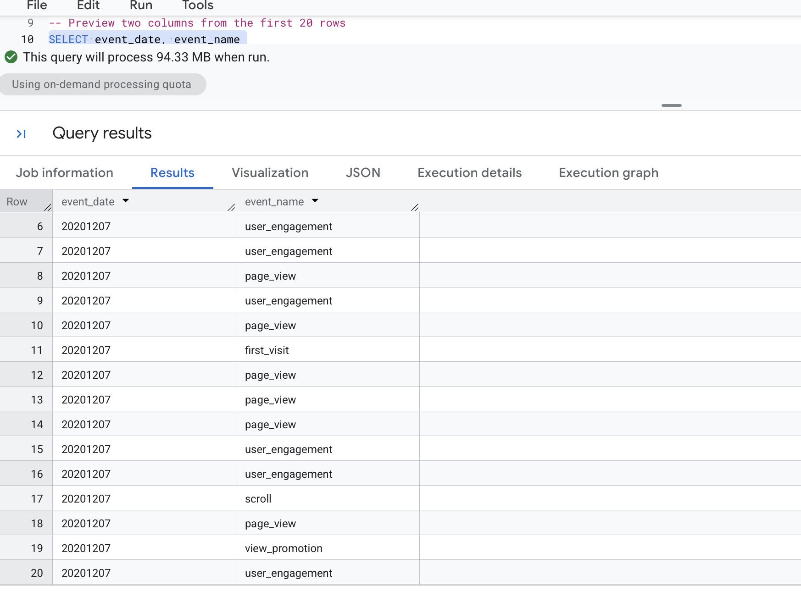
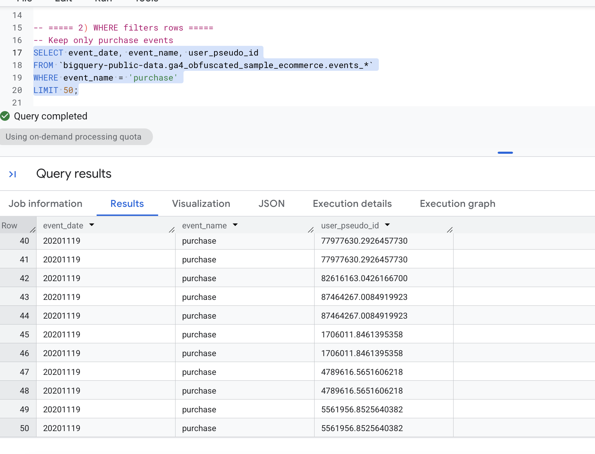
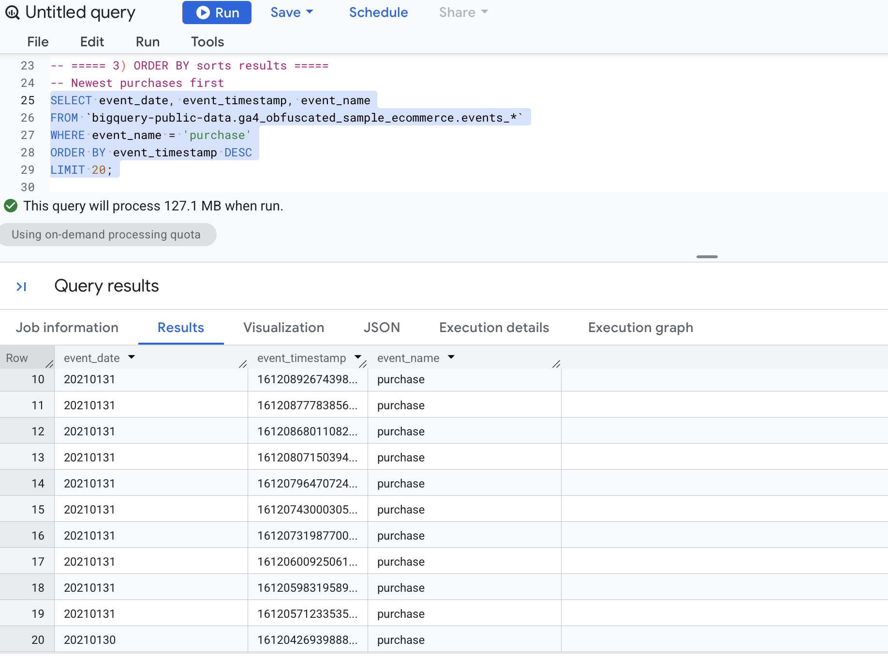
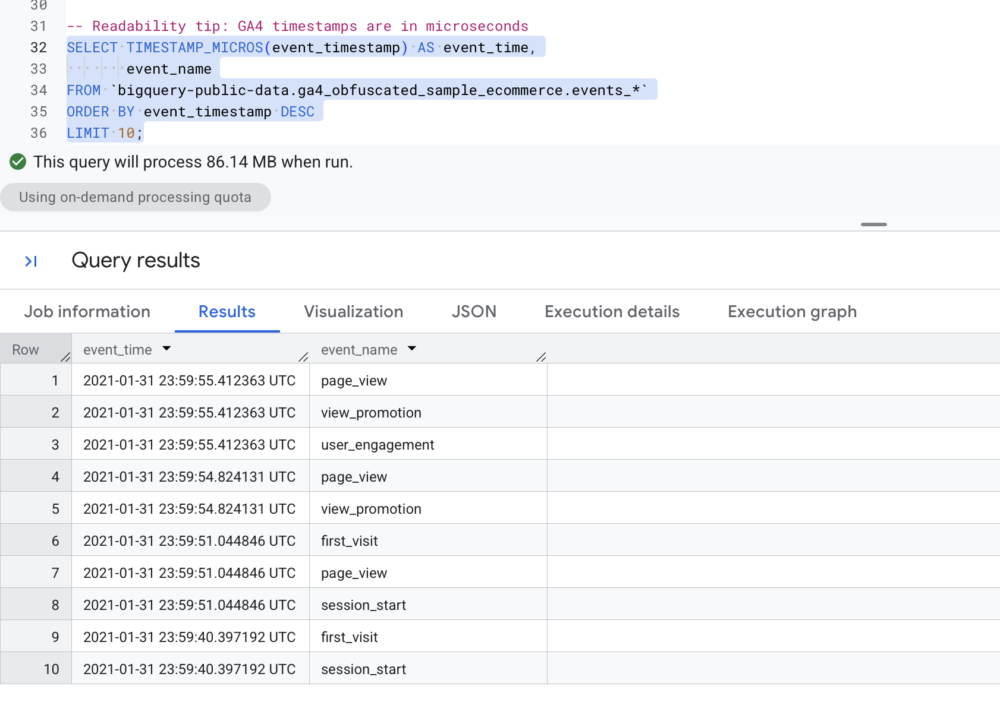
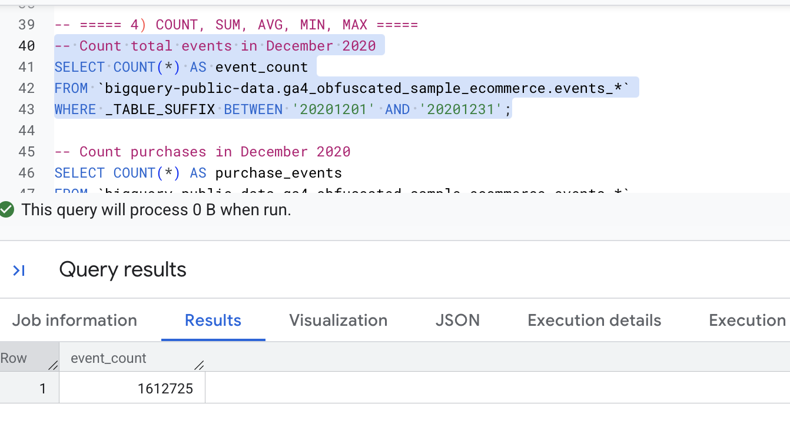
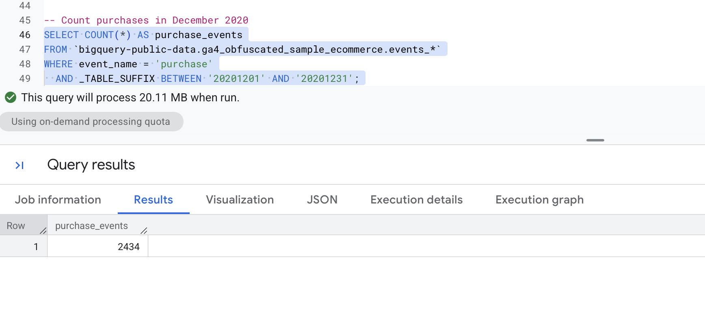
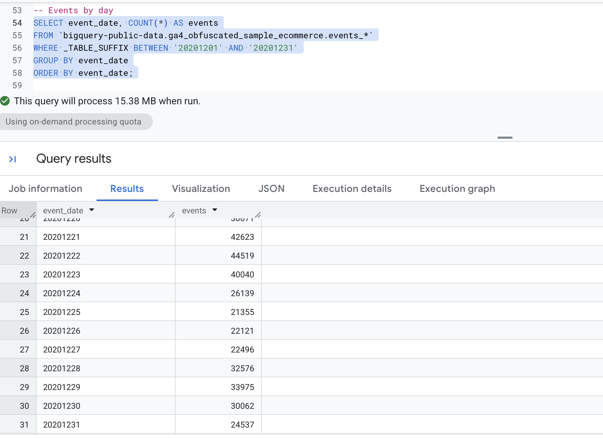
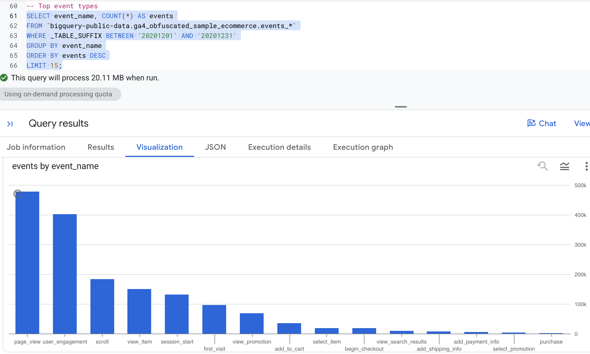
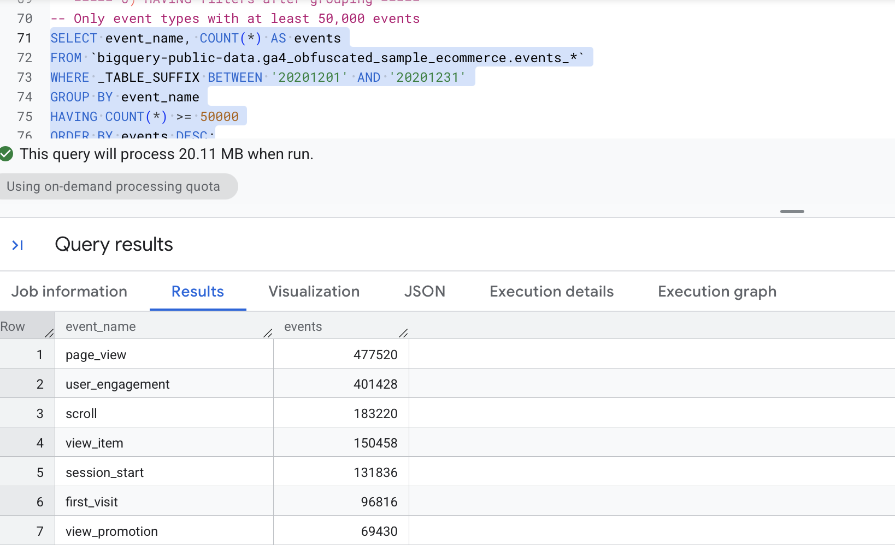
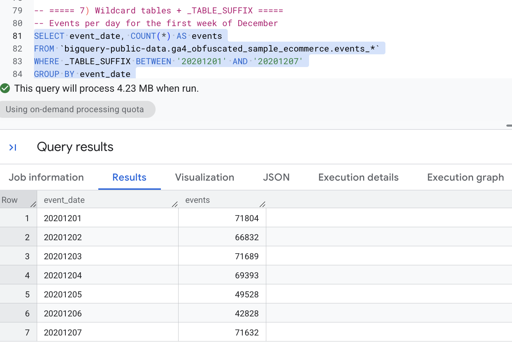

# Overview

This notebook walks through the queries from Lecture 1. All queries run in BigQuery against Google's public GA4 sample dataset, `bigquery-public-data.ga4_obfuscated_sample_ecommerce`. This is obfuscated event data from the Google Merchandise Store, covering Nov 2020 to Jan 2021.

Each GA4 event is one row. The daily tables are named `events_YYYYMMDD`, and `events_*` lets me query many days at once.

The SQL blocks below are fenced `sql` blocks, so they show syntax colors but do not execute when the document renders. The screenshots show the output from BigQuery.

# Basic Queries

## SELECT / FROM / LIMIT

**What it does:** `SELECT` picks the columns, `FROM` picks the table, and `LIMIT` caps how many rows come back. This is the quickest way to preview the data.

``` sql
SELECT event_date, event_name
FROM `bigquery-public-data.ga4_obfuscated_sample_ecommerce.events_*`
LIMIT 20;
```

{width="743"}

**What I noticed:** event names show up with underscores as spaces and what the date format is a string of numbers with no pattern.

## WHERE Filters Rows

**What it does:** `WHERE` keeps only the rows that match a condition. Here I keep only `purchase` events.

``` sql
SELECT event_date, event_name, user_pseudo_id
FROM `bigquery-public-data.ga4_obfuscated_sample_ecommerce.events_*`
WHERE event_name = 'purchase'
LIMIT 50;
```

{width="743"}

**What I noticed:** every row is a purchase, and `user_pseudo_id` is an anonymous device/browser ID

## ORDER BY Sorts Results

**What it does:** `ORDER BY` sorts the output. `DESC` puts the newest or largest first, and `ASC` is the default. Here the newest purchases come first.

``` sql
SELECT event_date, event_timestamp, event_name
FROM `bigquery-public-data.ga4_obfuscated_sample_ecommerce.events_*`
WHERE event_name = 'purchase'
ORDER BY event_timestamp DESC
LIMIT 20;
```

{width="742"}

### Readability Tip: Converting GA4 Timestamps

**What it does:** GA4 timestamps are stored in microseconds since 1970, which is hard to read. `TIMESTAMP_MICROS()` converts them into a normal date and time, and `AS event_time` gives the column a friendly name.

``` sql
SELECT TIMESTAMP_MICROS(event_timestamp) AS event_time,
       event_name
FROM `bigquery-public-data.ga4_obfuscated_sample_ecommerce.events_*`
ORDER BY event_timestamp DESC
LIMIT 10;
```

{width="743"}

**What I noticed:** Dates and time in YYYY-MM-DD and time in UTC with event_name

# Aggregate Functions

`COUNT`, `SUM`, `AVG`, `MIN`, and `MAX` collapse many rows into a single summary value.

## Count Total Events in a Date Range

**What it does:** `COUNT(*)` counts every row, which here means every event. `_TABLE_SUFFIX` is the date part of the table name, so the `BETWEEN` limits the query to December 2020 only.

``` sql
SELECT COUNT(*) AS event_count
FROM `bigquery-public-data.ga4_obfuscated_sample_ecommerce.events_*`
WHERE _TABLE_SUFFIX BETWEEN '20201201' AND '20201231';
```

{width="629"}**\
\
What I noticed:** December 2020 had **1,612,725 total events.**

## Count Purchases in a Date Range

**What it does:** This combines a row filter (`event_name = 'purchase'`) with the date range filter, so it counts only purchase events in December.

``` sql
SELECT COUNT(*) AS purchase_events
FROM `bigquery-public-data.ga4_obfuscated_sample_ecommerce.events_*`
WHERE event_name = 'purchase'
  AND _TABLE_SUFFIX BETWEEN '20201201' AND '20201231';
```

{width="564"}

**What I noticed:** There were 2434 purchase events in December, which is .15% of all events.

# GROUP BY Controls the Grain

`GROUP BY` defines what one row of the result represents (per day, per event type, per user, and so on). Every column in `SELECT` must either be in the `GROUP BY` or be wrapped in an aggregate function.

## Events by Day

**What it does:** One row per day, with the number of events that day. `ORDER BY event_date` puts the days in calendar order.

``` sql
SELECT event_date, COUNT(*) AS events
FROM `bigquery-public-data.ga4_obfuscated_sample_ecommerce.events_*`
WHERE _TABLE_SUFFIX BETWEEN '20201201' AND '20201231'
GROUP BY event_date
ORDER BY event_date;
```

{width="567"}

**What I noticed:** busiest and slowest days, spike around the holidays

## Top Event Types

**What it does:** One row per event type, sorted from most to least common, showing the top 15.

``` sql
SELECT event_name, COUNT(*) AS events
FROM `bigquery-public-data.ga4_obfuscated_sample_ecommerce.events_*`
WHERE _TABLE_SUFFIX BETWEEN '20201201' AND '20201231'
GROUP BY event_name
ORDER BY events DESC
LIMIT 15;
```

{width="648"}

**What I noticed:** `page_view` is probably the most common, and `purchase` is far down the list

# HAVING Filters After Grouping

**What it does:** `WHERE` filters rows *before* grouping, and `HAVING` filters the grouped results *after* the aggregation. This keeps only event types with at least 50,000 events.

``` sql
SELECT event_name, COUNT(*) AS events
FROM `bigquery-public-data.ga4_obfuscated_sample_ecommerce.events_*`
WHERE _TABLE_SUFFIX BETWEEN '20201201' AND '20201231'
GROUP BY event_name
HAVING COUNT(*) >= 50000
ORDER BY events DESC;
```

{width="735"}

**What I noticed:** 7 event types made the cut

# Wildcard Tables and \_TABLE_SUFFIX

**What it does:** GA4 exports one table per day (`events_20201201`, and so on). The `*` wildcard queries all of them as if they were one table, and `_TABLE_SUFFIX` limits which days are scanned. Scanning fewer tables makes the query faster and cheaper.

``` sql
SELECT event_date, COUNT(*) AS events
FROM `bigquery-public-data.ga4_obfuscated_sample_ecommerce.events_*`
WHERE _TABLE_SUFFIX BETWEEN '20201201' AND '20201207'
GROUP BY event_date
ORDER BY event_date;
```

{width="666"}

**What I noticed:** \[fill in, should be 7 rows, one for each day of the first week of December\]

# Key Takeaways

- `SELECT ... FROM ... WHERE ... GROUP BY ... HAVING ... ORDER BY ... LIMIT` is the general order of a query.
- `WHERE` filters rows before grouping, and `HAVING` filters after.
- Always filter `_TABLE_SUFFIX` on wildcard tables, because it controls how much data is scanned.
- GA4 timestamps are in microseconds, so convert them with `TIMESTAMP_MICROS()`.

# Links

- GitHub Pages: \[<https://dmcpp26.github.io/ibm6500-assignments/lecture1-ga4.html>\]
- GitHub Repo: \[<https://github.com/dmcpp26/ibm6500-assignments>\]