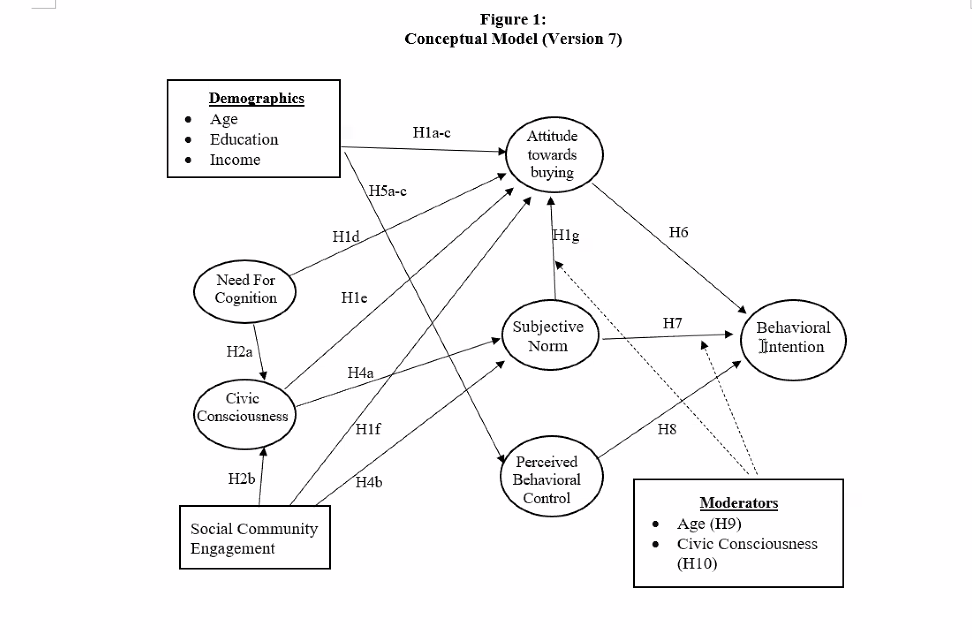
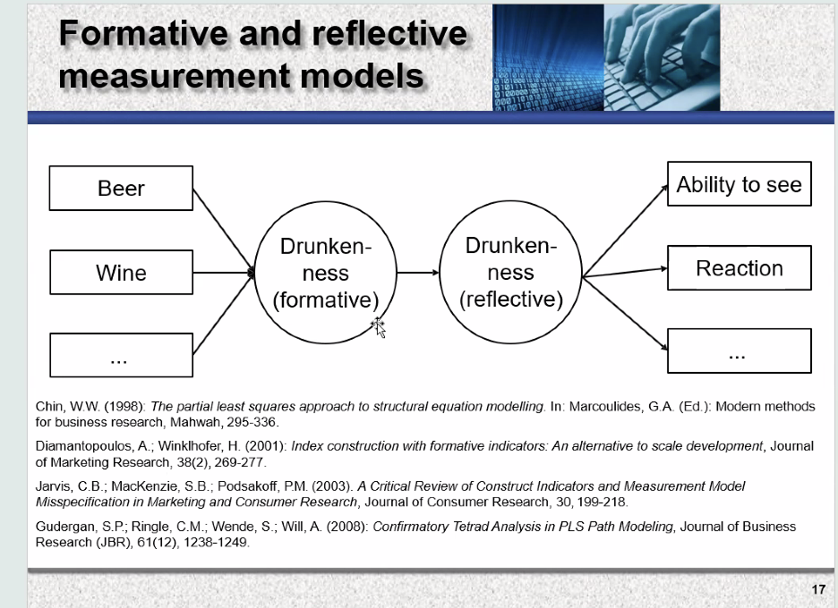

# Announcements

- CEP Assignments and Deadlines

- needs to be a indent in yaml for it to work successfully. this will allow it to render later

  ### IRB Application

  Once surveys ar writtena nd chpaters 1- 3 are fully written we are ready for IRB Application

- <https://www.cpp.edu/research/research-compliance/irb/protocol.shtml>

- Everyone needs a Cayuse Human Ethics account!!

  ## Initial Presentation

- Presentation slides and story telling

- if you want to swap presentation times you need to reach out and find a group willing to switch

  MSDM Initial Proposal Presentation I (Monday IBM 6200):  

  Date: Oct. 19, 2026 

  |  |  |  |  |  |
  |----|----|----|----|----|
  | Time  | Group Number  | Faculty Lead  | Client  | Note  |
  | 7:00 - 7:28  | Group 9  | Dr. Kwok  | RKR  | Faculty preferred this time slot  |
  | 7:30 - 7:58  | Group 6  | Dr. Yi Xie  | PhD Orthodontics  |   |
  | 8:00 - 8:25  | Group 7  | Dr. Min  | Avenue Shabu  |   |
  | 8:30 - 8:58  | Group 2  | Prof. Porter  | Glendora Education Foundation  |   |
  | 9:00 – 9:28  | Group 1   | Prof. Moore  | CVRx  | Faculty preferred this time slot  |

  MSDM Initial Proposal Presentation II (Thursday IBM 6500):  

  Date: Oct. 22, 2026 

  |              |               |               |                  |       |
  |--------------|---------------|---------------|------------------|-------|
  | Time         | Group Number  | Faculty Lead  | Client           | Note  |
  | 7:00 - 7:28  | Group 3       | Dr. Kwok      | Collins College  |       |
  | 7:30 - 7:58  | Group 8       | Dr. Lin       | TBIF             |       |
  | 8:00 - 8:25  | Group 4       | Dr. Zhang     | Wellness Ranch   |       |
  | 8:30 - 8:58  | Group 5       | Dr. Jung      | CPP Farm Store   |       |

   

  ## Survey Design and Data collection

  

Qualtrics Part II Questionaire

