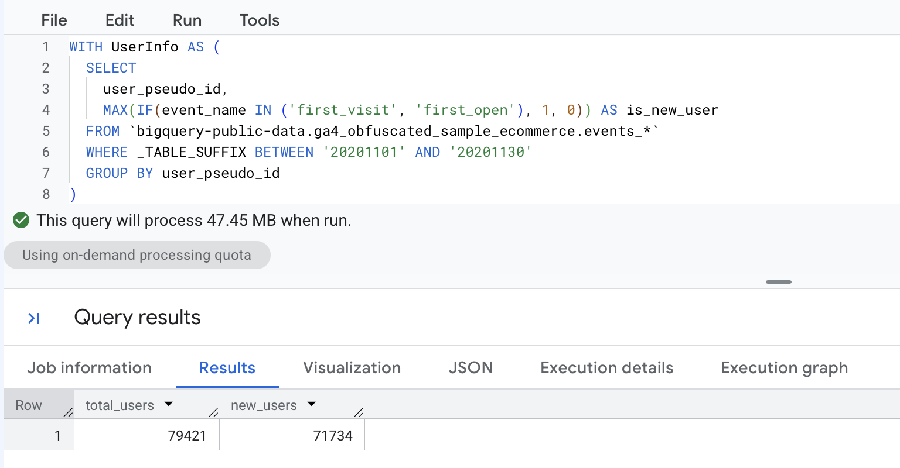
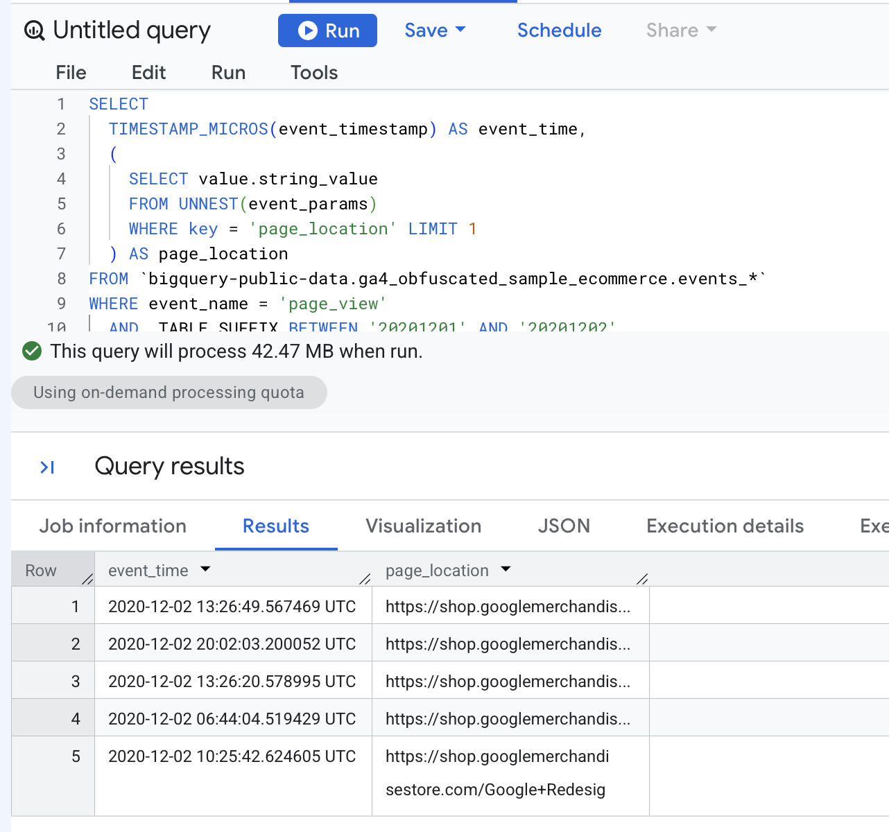
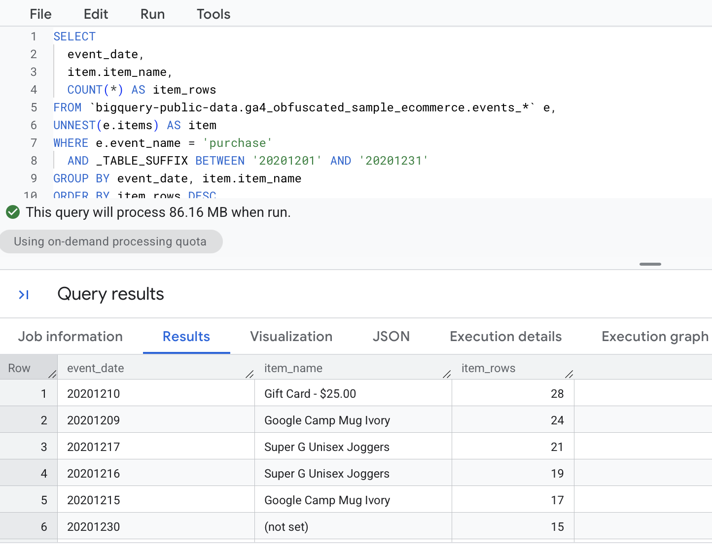
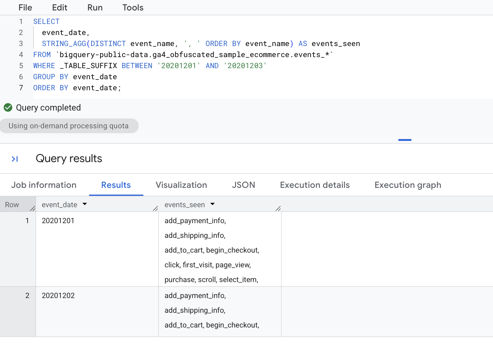
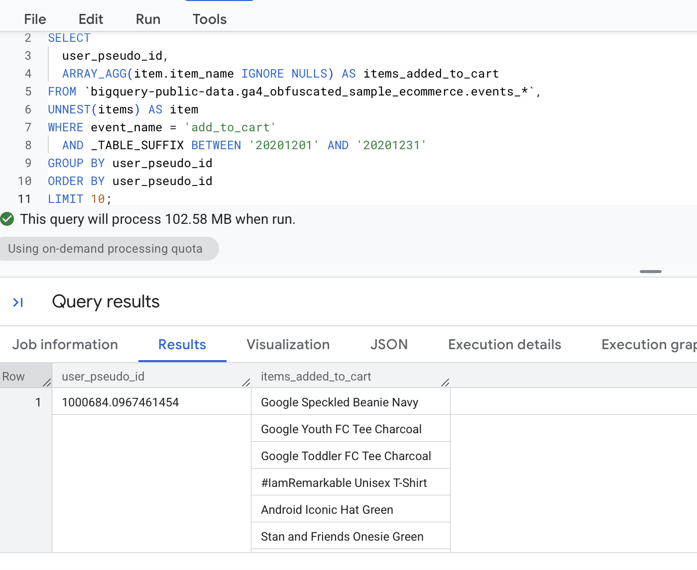
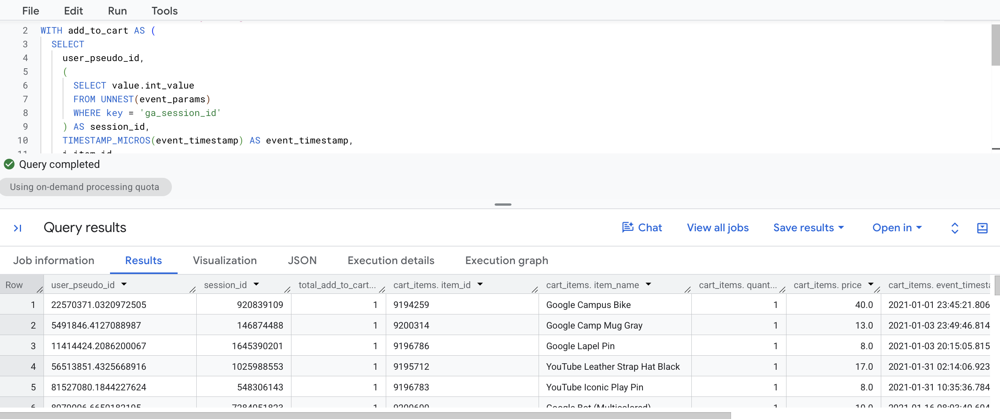
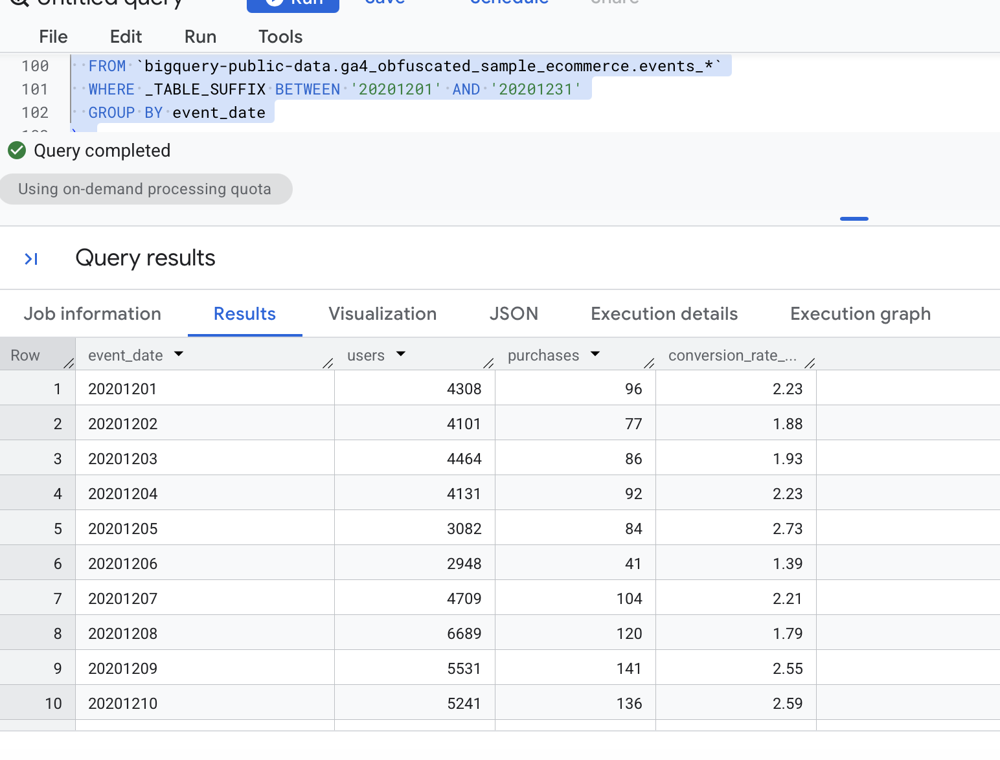
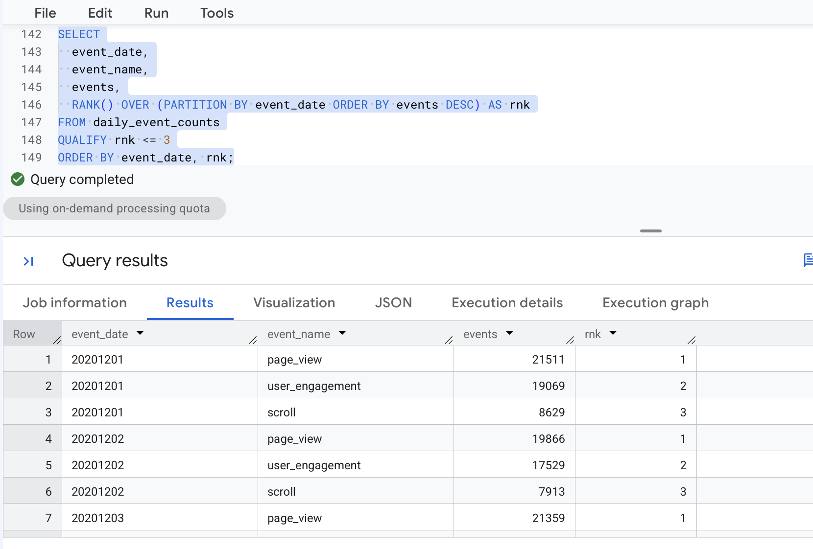
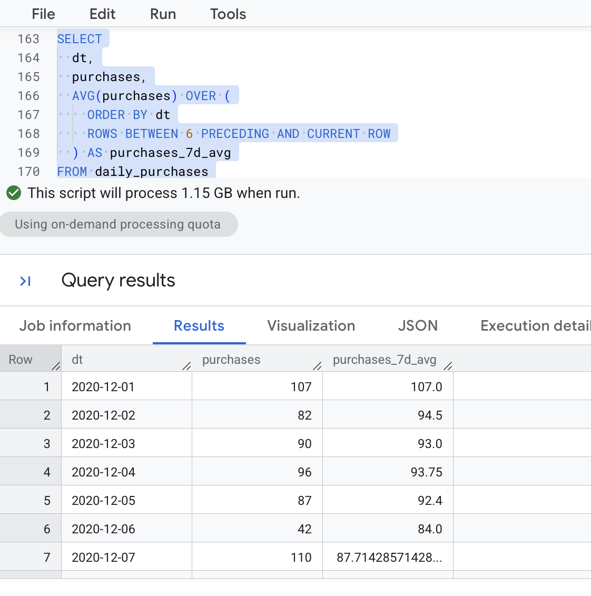
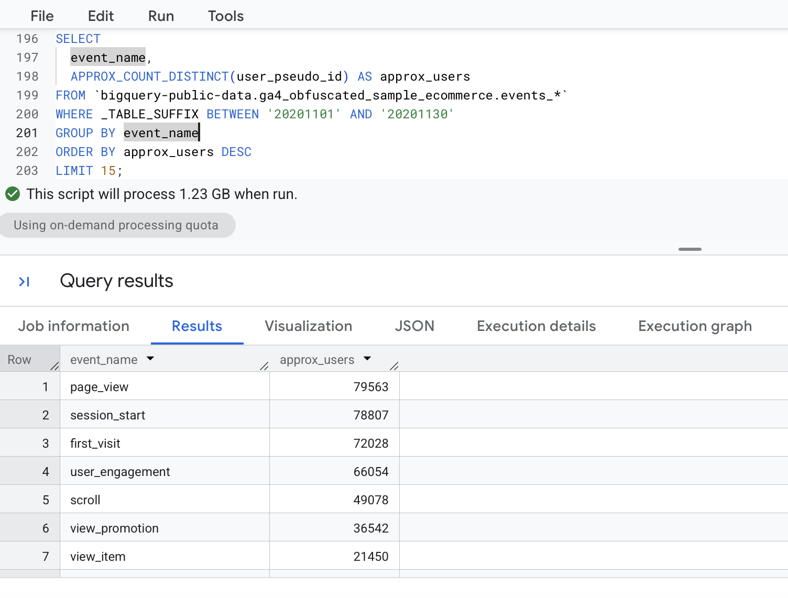

# Overview

This notebook walks through the queries from Lecture 2. All queries run in BigQuery against Google's public GA4 sample dataset, `bigquery-public-data.ga4_obfuscated_sample_ecommerce`, which covers Nov 2020 to Jan 2021. Each row is one GA4 event, and daily tables are named `events_YYYYMMDD`.

The SQL blocks below are fenced `sql` blocks, so they show syntax colors but do not execute when the document renders. The screenshots show the output from BigQuery.

# CTEs (WITH) to Structure Logic

## Total Users and New Users

**What it does:** `WITH` creates a named "mini table" (a CTE) inside the query. `UserInfo` has one row per user (`GROUP BY user_pseudo_id`) for November 2020. `MAX(IF(...))` sets `is_new_user` to 1 if that user had a `first_visit` or `first_open` event. The final `SELECT` counts the rows (total users) and sums the flag (new users).

``` sql
WITH UserInfo AS (
  SELECT
    user_pseudo_id,
    MAX(IF(event_name IN ('first_visit', 'first_open'), 1, 0)) AS is_new_user
  FROM `bigquery-public-data.ga4_obfuscated_sample_ecommerce.events_*`
  WHERE _TABLE_SUFFIX BETWEEN '20201101' AND '20201130'
  GROUP BY user_pseudo_id
)
SELECT
  COUNT(*) AS total_users,
  SUM(is_new_user) AS new_users
FROM UserInfo;
```



**What I noticed:** total users = 79,421 and new users = 71,734

# Arrays and UNNEST

GA4 stores many fields inside arrays: `event_params` (key/value pairs) and `items` (products in commerce events). There are two common patterns.

## Pattern A: Scalar Subquery Extraction

**What it does:** Pulls one parameter (`page_location`) out of the `event_params` array for each `page_view` event, without adding rows. `UNNEST` opens the array inside a subquery, `WHERE key = 'page_location'` picks the right entry, and `LIMIT 1` makes sure only one value comes back.

``` sql
SELECT
  TIMESTAMP_MICROS(event_timestamp) AS event_time,
  (
    SELECT value.string_value
    FROM UNNEST(event_params)
    WHERE key = 'page_location' LIMIT 1
  ) AS page_location
FROM `bigquery-public-data.ga4_obfuscated_sample_ecommerce.events_*`
WHERE event_name = 'page_view'
  AND _TABLE_SUFFIX BETWEEN '20201201' AND '20201202'
LIMIT 50;
```



**What I noticed:** all start with the same domain name - https://shop.googlemerchandisestore.com

## Pattern B: Flattening with UNNEST in FROM

**What it does:** `UNNEST(e.items)` in the `FROM` clause "explodes" the `items` array, so each purchase event becomes one row per item. The query then counts item rows by date and item name. The grain changes from one row per event to one row per item per event, so `item_rows` counts item lines and not units sold.

``` sql
SELECT
  event_date,
  item.item_name,
  COUNT(*) AS item_rows
FROM `bigquery-public-data.ga4_obfuscated_sample_ecommerce.events_*` e,
UNNEST(e.items) AS item
WHERE e.event_name = 'purchase'
  AND _TABLE_SUFFIX BETWEEN '20201201' AND '20201231'
GROUP BY event_date, item.item_name
ORDER BY item_rows DESC
LIMIT 20;
```



**What I noticed:** top-selling items were the gift card, mug ivory, unisex joggers, and camp Mug Ivory

# STRING_AGG and ARRAY_AGG

These aggregations combine many values into one row per group.

## Event Names Seen Per Day

**What it does:** `STRING_AGG(DISTINCT event_name, ', ' ORDER BY event_name)` joins the distinct event names into one comma-separated text value for each day.

``` sql
SELECT
  event_date,
  STRING_AGG(DISTINCT event_name, ', ' ORDER BY event_name) AS events_seen
FROM `bigquery-public-data.ga4_obfuscated_sample_ecommerce.events_*`
WHERE _TABLE_SUFFIX BETWEEN '20201201' AND '20201203'
GROUP BY event_date
ORDER BY event_date;
```



**What I noticed:** Dates with events from each day!

## Cart Summary, Use Case 1: Items Added to Cart Per User

**What it does:** Unnests `items` for `add_to_cart` events, then uses `ARRAY_AGG` to collect each user's item names into one array. Note that the lecture comment says "per session", but this version groups by `user_pseudo_id`, so it is per user. Use Case 2 below does it by session. I added `item.` before `item_name` and `IGNORE NULLS` so the array can't contain a NULL, which BigQuery rejects.

``` sql
-- Task: Create a list of items per user
SELECT
  user_pseudo_id,
  ARRAY_AGG(item.item_name IGNORE NULLS) AS items_added_to_cart
FROM `bigquery-public-data.ga4_obfuscated_sample_ecommerce.events_*`,
UNNEST(items) AS item
WHERE event_name = 'add_to_cart'
  AND _TABLE_SUFFIX BETWEEN '20201201' AND '20201231'
GROUP BY user_pseudo_id
ORDER BY user_pseudo_id
LIMIT 10;
```



**What I noticed:** items added to the card associated with each user.

## Cart Summary, Use Case 2: Session-Level Cart Summary

**What it does:** The CTE `add_to_cart` pulls the `ga_session_id` out of `event_params` and unnests the items for each add-to-cart event. The final query groups by user and session, counts the add-to-cart events, and uses `ARRAY_AGG(STRUCT(...) ORDER BY ... LIMIT 10)` to keep up to 10 cart items per session (largest quantity first). `session_id IS NOT NULL` removes rows without a session. The sample dataset ends on 2021-01-31, so the 2021 date filter only returns January 2021; it is there to control cost.

``` sql
-- Session-level "cart summary" using ARRAY_AGG
WITH add_to_cart AS (
  SELECT
    user_pseudo_id,
    (
      SELECT value.int_value
      FROM UNNEST(event_params)
      WHERE key = 'ga_session_id'
    ) AS session_id,
    TIMESTAMP_MICROS(event_timestamp) AS event_timestamp,
    i.item_id,
    i.item_name,
    i.quantity,
    i.price
  FROM `bigquery-public-data.ga4_obfuscated_sample_ecommerce.events_*`,
  UNNEST(items) AS i
  WHERE event_name = 'add_to_cart'
    AND _TABLE_SUFFIX BETWEEN '20210101' AND '20211231'  -- cost control
)
SELECT
  user_pseudo_id,
  session_id,
  COUNT(*) AS total_add_to_cart_events,
  ARRAY_AGG(
    STRUCT(item_id, item_name, quantity, price, event_timestamp)
    ORDER BY quantity DESC, event_timestamp ASC
    LIMIT 10
  ) AS cart_items
FROM add_to_cart
WHERE session_id IS NOT NULL
GROUP BY user_pseudo_id, session_id;
```



**What I noticed:** cart summary with users and session ID

# Joins

## Daily Users Joined with Daily Purchases

**What it does:** Two CTEs are built: `daily_users` (distinct users per day) and `daily_purchases` (distinct `transaction_id`s per day). A `LEFT JOIN` keeps every day from `daily_users`, even days with no purchases. `IFNULL(..., 0)` turns a missing purchase count into 0, and `NULLIF(u.users, 0)` avoids dividing by zero when calculating the conversion rate (purchases divided by users, as a percent).

``` sql
WITH daily_users AS (
  SELECT
    event_date,
    COUNT(DISTINCT user_pseudo_id) AS users
  FROM `bigquery-public-data.ga4_obfuscated_sample_ecommerce.events_*`
  WHERE _TABLE_SUFFIX BETWEEN '20201201' AND '20201231'
  GROUP BY event_date
),
daily_purchases AS (
  SELECT
    event_date,
    COUNT(DISTINCT
      (SELECT value.string_value
       FROM UNNEST(event_params)
       WHERE key = 'transaction_id')
    ) AS purchases    -- distinct transactions
  FROM `bigquery-public-data.ga4_obfuscated_sample_ecommerce.events_*`
  WHERE event_name = 'purchase'
    AND _TABLE_SUFFIX BETWEEN '20201201' AND '20201231'
  GROUP BY event_date
)
SELECT
  u.event_date,
  u.users,
  -- turns "no purchase row (NULL)" into 0 purchases, which is what you want for a daily time series
  IFNULL(p.purchases, 0) AS purchases,
  -- Conversion rate: what % of daily users made a purchase
  ROUND(
    IFNULL(p.purchases, 0) / NULLIF(u.users, 0) * 100, 2
  ) AS conversion_rate_pct        -- NULLIF prevents division by zero
FROM daily_users u
LEFT JOIN daily_purchases p
  ON u.event_date = p.event_date
ORDER BY u.event_date;
```



**What I noticed:** typical conversion rate and any unusual days

# Window Functions and QUALIFY

Window functions calculate "across rows" without collapsing the result to one row per group.

## Top 3 Event Types Per Day

**What it does:** The CTE counts events per day and event type. `RANK() OVER (PARTITION BY event_date ORDER BY events DESC)` ranks event types within each day, and `QUALIFY rnk <= 3` keeps only the top three per day. `QUALIFY` filters on window function results, much like `HAVING` filters on aggregates.

``` sql
WITH daily_event_counts AS (
  SELECT
    event_date,
    event_name,
    COUNT(*) AS events
  FROM `bigquery-public-data.ga4_obfuscated_sample_ecommerce.events_*`
  WHERE _TABLE_SUFFIX BETWEEN '20201201' AND '20201207'
  GROUP BY event_date, event_name
)
SELECT
  event_date,
  event_name,
  events,
  RANK() OVER (PARTITION BY event_date ORDER BY events DESC) AS rnk
FROM daily_event_counts
QUALIFY rnk <= 3
ORDER BY event_date, rnk;
```



**What I noticed:** top three events were page_view, user_engagement, and scroll

## Rolling 7-Day Average of Daily Purchases

**What it does:** Counts purchases per day (`PARSE_DATE` converts the text `event_date` into a real date). Then `AVG(purchases) OVER (ORDER BY dt ROWS BETWEEN 6 PRECEDING AND CURRENT ROW)` averages each day with the six days before it, which gives a smoothed 7-day trend. The first six days average over fewer than seven days.

``` sql
WITH daily_purchases AS (
  SELECT
    PARSE_DATE('%Y%m%d', event_date) AS dt,
    COUNT(*) AS purchases
  FROM `bigquery-public-data.ga4_obfuscated_sample_ecommerce.events_*`
  WHERE event_name = 'purchase'
    AND _TABLE_SUFFIX BETWEEN '20201201' AND '20201231'
  GROUP BY dt
)
SELECT
  dt,
  purchases,
  AVG(purchases) OVER (
    ORDER BY dt
    ROWS BETWEEN 6 PRECEDING AND CURRENT ROW
  ) AS purchases_7d_avg
FROM daily_purchases
ORDER BY dt;
```



**What I noticed:** the 7-day average smooths the daily swings

# Approximate Functions

**What it does:** `APPROX_COUNT_DISTINCT` returns an approximate count of distinct users per event type. It is "close enough" and much faster than an exact `COUNT(DISTINCT ...)` on very large datasets.

``` sql
SELECT
  event_name,
  APPROX_COUNT_DISTINCT(user_pseudo_id) AS approx_users
FROM `bigquery-public-data.ga4_obfuscated_sample_ecommerce.events_*`
WHERE _TABLE_SUFFIX BETWEEN '20201101' AND '20201130'
GROUP BY event_name
ORDER BY approx_users DESC
LIMIT 15;
```



**What I noticed:** approximate number of users that hit each event, looks like most of the users start with a page view less than half make it to actually view the item.

# Key Takeaways

- CTEs (`WITH`) break a long query into named steps that are easier to read.
- GA4 stores `event_params` and `items` as arrays. Use a scalar subquery to pull one value without adding rows, and `UNNEST` in `FROM` to flatten, which changes the grain.
- `STRING_AGG` and `ARRAY_AGG` combine many values into one row per group.
- A `LEFT JOIN` keeps all rows from the left table, so combine it with `IFNULL` and `NULLIF` for clean metrics.
- Window functions (`RANK`, rolling `AVG`) work across rows, and `QUALIFY` filters on them.
- Always filter `_TABLE_SUFFIX` to control how much data a query scans.

# Appendix: Links

- **GitHub Pages:** [View my published report](https://dmcpp26.github.io/ibm6500-assignments/IC-CP-W05/lecture2-ga4.html)
- **GitHub Repo:** [dmcpp26/ibm6500-assignments](https://github.com/dmcpp26/ibm6500-assignments)