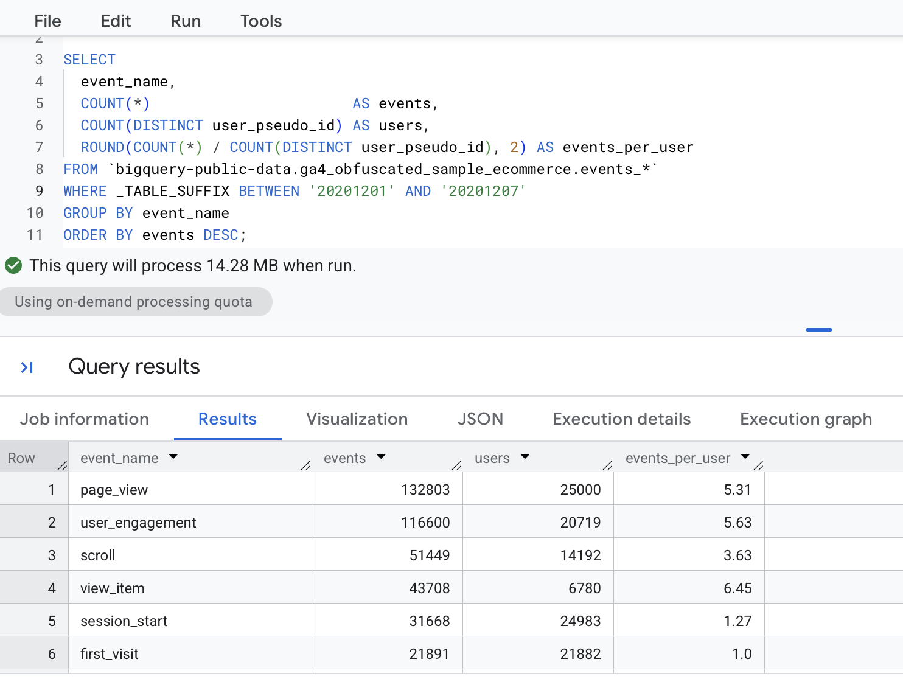
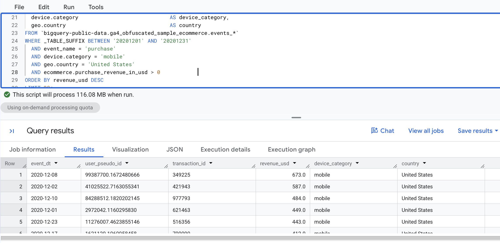
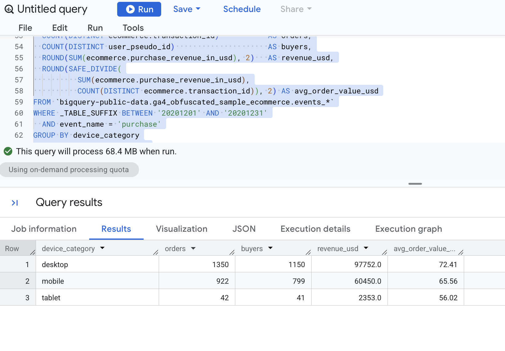
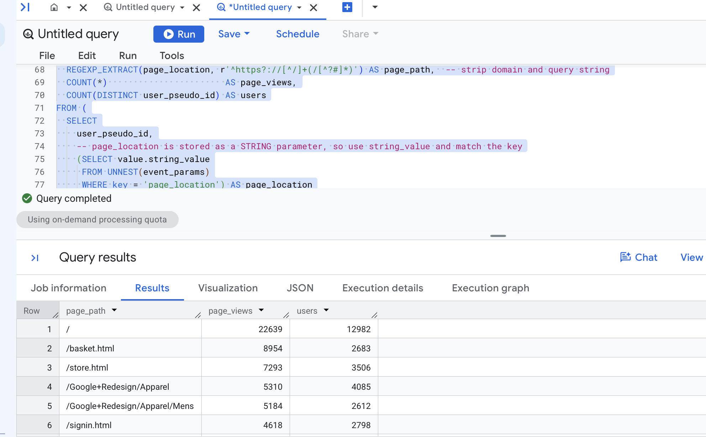
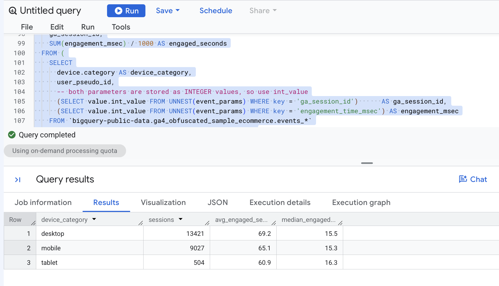
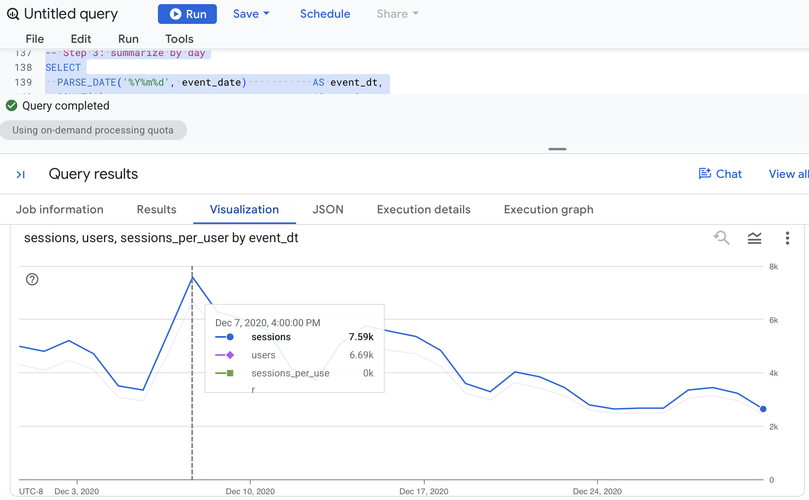
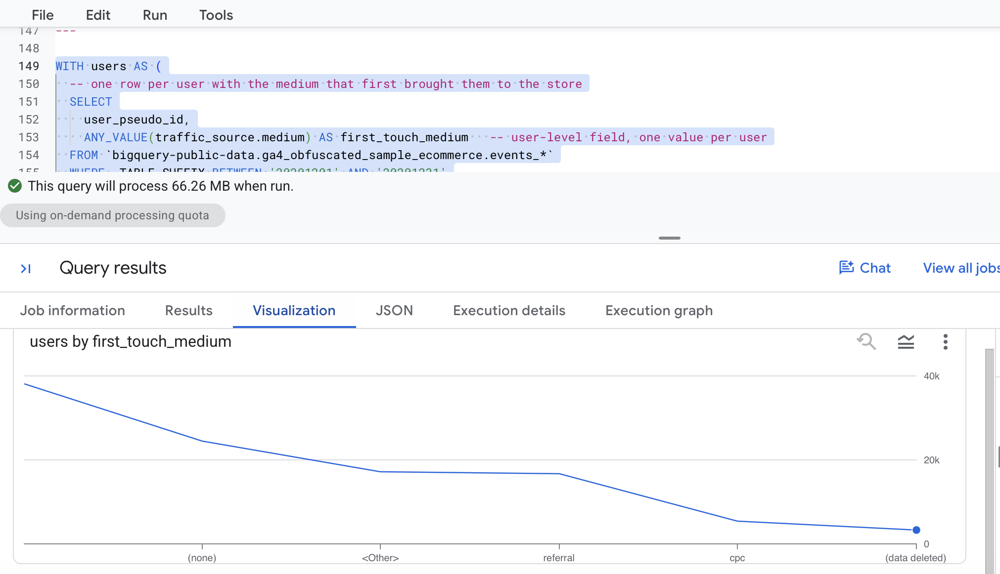
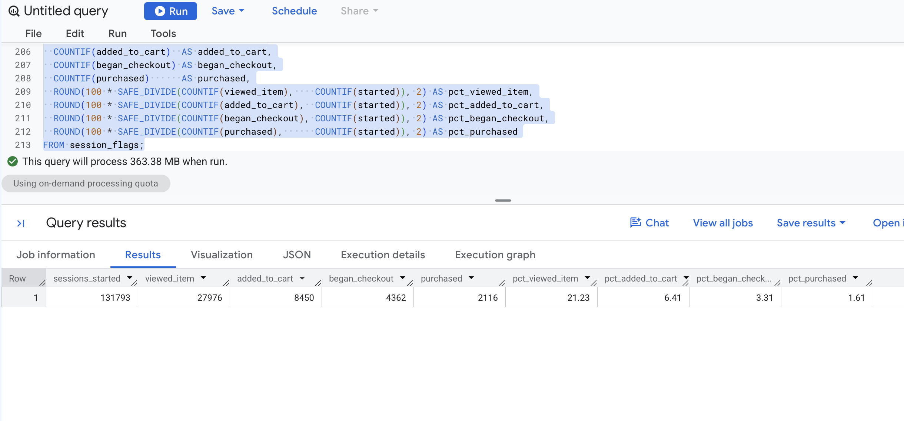

# Overview

This SQL pack contains eight BigQuery GoogleSQL queries written against the public GA4 sample e-commerce dataset, `bigquery-public-data.ga4_obfuscated_sample_ecommerce` (events from Nov 2020 to Jan 2021, one row per event, in daily tables named `events_YYYYMMDD`). Each query has a short explanation and a screenshot of its output from BigQuery.

The SQL blocks are fenced `sql` code, so they show syntax colors but do not execute when this document renders.

## Skill Coverage Map

| \# | Query | Filtering and scoping | Grouping and aggregation | UNNEST of `event_params` | CTE | Join or multi-step |
|:------|:-----------------------------|:----------:|:-----------:|:----------:|:--------:|:----------:|
| 1 | Event volume by event name | ✔ | ✔ |  |  |  |
| 2 | Largest US mobile purchases | ✔ |  |  |  |  |
| 3 | Revenue and order value by device | ✔ | ✔ |  |  |  |
| 4 | Top pages by page views | ✔ | ✔ | ✔ (string) |  |  |
| 5 | Engaged time per session by device | ✔ | ✔ | ✔ (int, two keys) |  |  |
| 6 | Sessions and sessions per user by day | ✔ | ✔ | ✔ (int) | ✔ |  |
| 7 | Buyer rate by first-touch medium | ✔ | ✔ |  | ✔ | ✔ (LEFT JOIN) |
| 8 | Session-level purchase funnel | ✔ | ✔ | ✔ (int) | ✔ (2 CTEs) | ✔ (multi-step) |

## Conventions Used in Every Query

- **Date scoping:** every query filters `_TABLE_SUFFIX` so BigQuery only scans the daily tables I need (less cost, faster results).
- **Event vs. user vs. session:** each explanation states which one is being counted. `COUNT(*)` counts **events**, `COUNT(DISTINCT user_pseudo_id)` counts **users**, and a **session** is the pair `user_pseudo_id` + `ga_session_id`.
- **Parameter extraction:** `event_params` is an array of key/value pairs. I always match the `key` and choose the right value column (`string_value`, `int_value`, or `double_value`).
- **Style:** uppercase keywords, one clause per line, and clear aliases so a teammate can reuse the query.

# Filtering, Scoping, and Aggregation

## Query 1: Event Volume by Event Name

``` sql
-- Q1: How many events, and how many users, fire for each event type in the first week of December 2020?
SELECT
  event_name,
  COUNT(*)                       AS events,          -- every event row
  COUNT(DISTINCT user_pseudo_id) AS users,           -- unique users who fired the event
  ROUND(COUNT(*) / COUNT(DISTINCT user_pseudo_id), 2) AS events_per_user
FROM `bigquery-public-data.ga4_obfuscated_sample_ecommerce.events_*`
WHERE _TABLE_SUFFIX BETWEEN '20201201' AND '20201207'   -- scan one week, not the whole dataset
GROUP BY event_name
ORDER BY events DESC;
```



**This query answers** which events dominate the data and how many different users trigger each one. **It works by** filtering to one week of daily tables, grouping by `event_name`, and comparing `COUNT(*)` (events) with `COUNT(DISTINCT user_pseudo_id)` (users). **You'd use it** as a first look at any GA4 export, to see which events exist before building anything on top of them. **Caveat:** events per user is not sessions per user, and a user who fires `page_view` ten times counts as one user but ten events. **What I noticed:** top three events were "page_view", "user_engagement", and "scroll". The events-per-user ratio for `page_view 5.31` vs. `purchase 1.14`

## Query 2: Largest US Mobile Purchases

``` sql
-- Q2: Which individual purchases from US mobile users brought in the most revenue in December 2020?
SELECT
  PARSE_DATE('%Y%m%d', event_date)            AS event_dt,
  user_pseudo_id,
  ecommerce.transaction_id                    AS transaction_id,
  ecommerce.purchase_revenue_in_usd           AS revenue_usd,
  device.category                             AS device_category,
  geo.country                                 AS country
FROM `bigquery-public-data.ga4_obfuscated_sample_ecommerce.events_*`
WHERE _TABLE_SUFFIX BETWEEN '20201201' AND '20201231'  
  AND event_name = 'purchase'                          
  AND device.category = 'mobile'                       
  AND geo.country = 'United States'                    
  AND ecommerce.purchase_revenue_in_usd > 0            
ORDER BY revenue_usd DESC
LIMIT 20;
```



**This query answers** which specific orders were the largest for one segment (US, mobile). **It works by** stacking four filters (date range, event name, device, country) on the raw event table and sorting by revenue. **You'd use it** to inspect high-value orders or to sanity-check revenue before aggregating it. **Caveat:** `purchase_revenue_in_usd` is already in USD, and the same `transaction_id` can appear on more than one purchase event, so check for duplicates before summing. **What I noticed:** the largest order took place december 8th and i didnt notice any transaction IDs repeat

## Query 3: Revenue and Average Order Value by Device

``` sql
-- Q3: How much revenue and how many orders does each device category generate in December 2020?
SELECT
  device.category                                    AS device_category,
  COUNT(DISTINCT ecommerce.transaction_id)           AS orders,
  COUNT(DISTINCT user_pseudo_id)                     AS buyers,
  ROUND(SUM(ecommerce.purchase_revenue_in_usd), 2)   AS revenue_usd,
  ROUND(SAFE_DIVIDE(
          SUM(ecommerce.purchase_revenue_in_usd),
          COUNT(DISTINCT ecommerce.transaction_id)), 2) AS avg_order_value_usd
FROM `bigquery-public-data.ga4_obfuscated_sample_ecommerce.events_*`
WHERE _TABLE_SUFFIX BETWEEN '20201201' AND '20201231'
  AND event_name = 'purchase'
GROUP BY device_category
ORDER BY revenue_usd DESC;
```



**This query answers** which device type drives the most revenue and which has the highest order value. **It works by** filtering to purchase events, grouping by device category, and combining `COUNT(DISTINCT ...)` and `SUM(...)`, with `SAFE_DIVIDE` so an empty group cannot cause a divide-by-zero error. **You'd use it** to compare device performance in a channel or revenue report. **Caveat:** order counts use distinct `transaction_id`, so if a transaction ID is missing or `(not set)` the order count and average order value will be off. **What I noticed:** Desktop has the most revenue and the highest average order value.

# UNNEST of Event Parameters

## Query 4: Top Pages by Page Views

``` sql
-- Q4: Which pages get the most page views in the first week of December 2020?
SELECT
  REGEXP_EXTRACT(page_location, r'^https?://[^/]+(/[^?#]*)') AS page_path,  -- strip domain and query string
  COUNT(*)                       AS page_views,
  COUNT(DISTINCT user_pseudo_id) AS users
FROM (
  SELECT
    user_pseudo_id,
    -- page_location is stored as a STRING parameter, so use string_value and match the key
    (SELECT value.string_value
     FROM UNNEST(event_params)
     WHERE key = 'page_location') AS page_location
  FROM `bigquery-public-data.ga4_obfuscated_sample_ecommerce.events_*`
  WHERE _TABLE_SUFFIX BETWEEN '20201201' AND '20201207'
    AND event_name = 'page_view'
)
GROUP BY page_path
ORDER BY page_views DESC
LIMIT 15;
```



**This query answers** which pages attract the most traffic. **It works by** using a scalar subquery on `UNNEST(event_params)` to pull the `page_location` string for each `page_view`, then `REGEXP_EXTRACT` to keep only the path, so the same page with different query strings is grouped together. **You'd use it** for a content or landing-page report. **Caveat:** the `WHERE key = 'page_location'` filter is essential, because without it the subquery would return the wrong parameter, and page views are events, so one user can add many. **What I noticed:** \[ the top page is the homepage and it dominates.

## Query 5: Engaged Time per Session by Device

``` sql
-- Q5: How many seconds are users actually engaged per session, by device category?
SELECT
  device_category,
  COUNT(*)                                          AS sessions,
  ROUND(AVG(engaged_seconds), 1)                    AS avg_engaged_seconds,
  ROUND(APPROX_QUANTILES(engaged_seconds, 2)[OFFSET(1)], 1) AS median_engaged_seconds
FROM (
  -- one row per session: add up engagement time over the session
  SELECT
    device_category,
    user_pseudo_id,
    ga_session_id,
    SUM(engagement_msec) / 1000 AS engaged_seconds
  FROM (
    SELECT
      device.category AS device_category,
      user_pseudo_id,
      -- both parameters are stored as INTEGER values, so use int_value
      (SELECT value.int_value FROM UNNEST(event_params) WHERE key = 'ga_session_id')      AS ga_session_id,
      (SELECT value.int_value FROM UNNEST(event_params) WHERE key = 'engagement_time_msec') AS engagement_msec
    FROM `bigquery-public-data.ga4_obfuscated_sample_ecommerce.events_*`
    WHERE _TABLE_SUFFIX BETWEEN '20201201' AND '20201207'
      AND event_name = 'user_engagement'
  )
  WHERE ga_session_id IS NOT NULL
    AND engagement_msec IS NOT NULL
  GROUP BY device_category, user_pseudo_id, ga_session_id
)
GROUP BY device_category
ORDER BY sessions DESC;
```



**This query answers** how long people are really engaged during a session on each device type. **It works by** extracting two integer parameters (`ga_session_id` and `engagement_time_msec`) from `event_params`, summing engagement per session (user + session ID), and then averaging across sessions with the average and the median side by side. **You'd use it** to judge content quality or compare devices on something better than raw page views. **Caveat:** only sessions that have a `user_engagement` event are included, so sessions with no such event are missing, and the average is pulled up by a few very long sessions, which is why I show the median too. **What I noticed:** For each device average engagement ranks them differently than median enagaged seconds, and desktop is higher

# CTEs, Joins, and Multi-Step Logic

## Query 6: Sessions and Sessions per User by Day

``` sql
-- Q6: How many sessions and users per day, and how many sessions does a typical user have?
WITH session_events AS (
  -- Step 1: attach the session ID (an INTEGER parameter) to every event
  SELECT
    event_date,
    user_pseudo_id,
    (SELECT value.int_value FROM UNNEST(event_params) WHERE key = 'ga_session_id') AS ga_session_id
  FROM `bigquery-public-data.ga4_obfuscated_sample_ecommerce.events_*`
  WHERE _TABLE_SUFFIX BETWEEN '20201201' AND '20201231'
),
sessions AS (
  -- Step 2: collapse to one row per user, session, and day
  SELECT event_date, user_pseudo_id, ga_session_id
  FROM session_events
  WHERE ga_session_id IS NOT NULL
  GROUP BY event_date, user_pseudo_id, ga_session_id
)
-- Step 3: summarize by day
SELECT
  PARSE_DATE('%Y%m%d', event_date)           AS event_dt,
  COUNT(*)                                   AS sessions,
  COUNT(DISTINCT user_pseudo_id)             AS users,
  ROUND(COUNT(*) / COUNT(DISTINCT user_pseudo_id), 2) AS sessions_per_user
FROM sessions
GROUP BY event_date
ORDER BY event_dt;
```



**This query answers** how daily traffic is trending in sessions and users, and how often the same user returns on the same day. **It works by** using two CTEs, one to extract `ga_session_id` and one to reduce events to unique sessions, so the final `SELECT` is short and easy to read. **You'd use it** as the base for traffic trend charts. **Caveat:** a session that crosses midnight is counted once on each day, so daily sessions can add up to slightly more than total sessions. **What I noticed:** peak days include: December 8, 9, 10, 15 and each sessions per user is pretty close to 1.

## Query 7: Buyer Rate by First-Touch Medium

``` sql
-- Q7: What share of users in each acquisition medium bought something in December 2020?
WITH users AS (
  -- one row per user with the medium that first brought them to the store
  SELECT
    user_pseudo_id,
    ANY_VALUE(traffic_source.medium) AS first_touch_medium   -- user-level field, one value per user
  FROM `bigquery-public-data.ga4_obfuscated_sample_ecommerce.events_*`
  WHERE _TABLE_SUFFIX BETWEEN '20201201' AND '20201231'
  GROUP BY user_pseudo_id
),
buyers AS (
  -- users who made at least one purchase
  SELECT DISTINCT user_pseudo_id
  FROM `bigquery-public-data.ga4_obfuscated_sample_ecommerce.events_*`
  WHERE _TABLE_SUFFIX BETWEEN '20201201' AND '20201231'
    AND event_name = 'purchase'
)
SELECT
  u.first_touch_medium,
  COUNT(*)                                   AS users,
  COUNT(b.user_pseudo_id)                    AS buyers,        -- non-NULL only when the LEFT JOIN found a match
  ROUND(100 * SAFE_DIVIDE(COUNT(b.user_pseudo_id), COUNT(*)), 2) AS buyer_rate_pct
FROM users AS u
LEFT JOIN buyers AS b
  USING (user_pseudo_id)
GROUP BY u.first_touch_medium
ORDER BY users DESC;
```



**This query answers** which acquisition mediums bring users who actually buy, not just users who show up. **It works by** building a user table and a buyer table in two CTEs, then using a `LEFT JOIN` so every user is kept, and counting the non-NULL matches as buyers. **You'd use it** to compare channel quality, and it is the same pattern needed to join paths to purchases in the team's attribution work. **Caveat:** `traffic_source` in the GA4 export is the user's *first-touch* source, not the source of the session that converted, so this is not last-click attribution. Also, a `(data deleted)` or `(none)` medium is a limitation of the sample data. **What I noticed:** Highest buyer rate was with a referral and Organic medium has the most users

## Query 8: Session-Level Purchase Funnel

``` sql
-- Q8: How many December sessions reach each step of the shopping funnel?
WITH funnel_events AS (
  -- Step 1: keep only funnel events and attach the session ID
  SELECT
    user_pseudo_id,
    (SELECT value.int_value FROM UNNEST(event_params) WHERE key = 'ga_session_id') AS ga_session_id,
    event_name
  FROM `bigquery-public-data.ga4_obfuscated_sample_ecommerce.events_*`
  WHERE _TABLE_SUFFIX BETWEEN '20201201' AND '20201231'
    AND event_name IN ('session_start', 'view_item', 'add_to_cart', 'begin_checkout', 'purchase')
),
session_flags AS (
  -- Step 2: one row per session with a TRUE/FALSE flag for each step
  SELECT
    user_pseudo_id,
    ga_session_id,
    LOGICAL_OR(event_name = 'session_start')  AS started,
    LOGICAL_OR(event_name = 'view_item')      AS viewed_item,
    LOGICAL_OR(event_name = 'add_to_cart')    AS added_to_cart,
    LOGICAL_OR(event_name = 'begin_checkout') AS began_checkout,
    LOGICAL_OR(event_name = 'purchase')       AS purchased
  FROM funnel_events
  WHERE ga_session_id IS NOT NULL
  GROUP BY user_pseudo_id, ga_session_id
)
-- Step 3: count sessions at each step and the share of started sessions
SELECT
  COUNTIF(started)        AS sessions_started,
  COUNTIF(viewed_item)    AS viewed_item,
  COUNTIF(added_to_cart)  AS added_to_cart,
  COUNTIF(began_checkout) AS began_checkout,
  COUNTIF(purchased)      AS purchased,
  ROUND(100 * SAFE_DIVIDE(COUNTIF(viewed_item),    COUNTIF(started)), 2) AS pct_viewed_item,
  ROUND(100 * SAFE_DIVIDE(COUNTIF(added_to_cart),  COUNTIF(started)), 2) AS pct_added_to_cart,
  ROUND(100 * SAFE_DIVIDE(COUNTIF(began_checkout), COUNTIF(started)), 2) AS pct_began_checkout,
  ROUND(100 * SAFE_DIVIDE(COUNTIF(purchased),      COUNTIF(started)), 2) AS pct_purchased
FROM session_flags;
```



**This query answers** where sessions drop out between starting a visit and purchasing. **It works by** using one CTE to extract the session ID for funnel events and a second CTE to turn events into one TRUE/FALSE flag per step per session (`LOGICAL_OR`), then `COUNTIF` counts sessions at each step. **You'd use it** to find the biggest drop-off in the shopping journey. **Caveat:** the flags show whether a step happened in the session, not that the steps happened in order, and sessions that began in November or before a table boundary may appear without `session_start`, so a step can exceed the "started" count. **What I noticed:** The biggest drop happened between view_item and add_to_cart. the overall purchase rate was 1.61.

# GA4 Notes and Common Pitfalls I Avoided

- **Wrong key or value type:** every `UNNEST(event_params)` subquery filters on the exact `key`, and I used `string_value` for `page_location` and `int_value` for `ga_session_id` and `engagement_time_msec`.
- **Missing date filters:** every query restricts `_TABLE_SUFFIX`, which keeps scans small.
- **Events, users, and sessions:** each explanation says which is counted. A session is `user_pseudo_id` + `ga_session_id`.
- **First-touch vs. session source:** the `traffic_source` fields describe where the user was first acquired, not the session's source.
- **Sample data limits:** the dataset is a small, obfuscated sample from the Google Merchandise Store, so values are for practice and not for real business conclusions.

# Appendix

## Project Links

- [GitHub Repository](https://github.com/dmcpp26/ibm6500-assignments)
- [GitHub Pages Website](https://dmcpp26.github.io/ibm6500-assignments/M04-SQL-Pack/sql-pack-m4-dmeza.html)